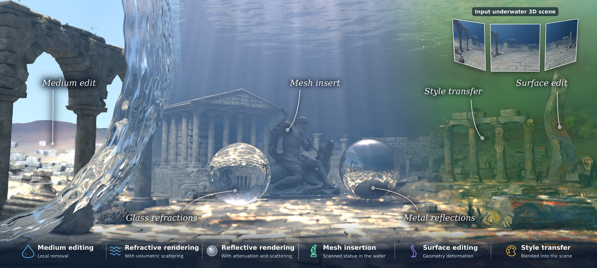

<h1 align="center">FoamSurf: A Voronoi-Surfel Representation for Differentiable Rendering</h1>

<p align="center">
  <a href="https://grzegorzwilczynski.com">Grzegorz Wilczyński<sup>1,3</sup></a>,
  <a href="https://scholar.google.com/citations?user=drMAA2UAAAAJ">Julia Farganus<sup>4</sup></a>,
  <a href="https://scholar.google.com/citations?user=ef2YKtsAAAAJ&hl=pl&oi=sra">Krzysztof Byrski<sup>1</sup></a>,
  <a href="https://scholar.google.com/citations?user=DGiaI64AAAAJ">Rafał Tobiasz<sup>1,3</sup></a>,
  <a href="https://github.com/MikolajZielinski">Mikołaj Zieliński<sup>2,5</sup></a>,
  <a href="https://scholar.google.com/citations?user=3XvUbbMAAAAJ&hl=en">Dominik Belter<sup>2</sup></a>,
  <a href="https://scholar.google.com/citations?user=0kp0MbgAAAAJ&hl=en">Przemysław Spurek<sup>1,3</sup></a>
</p>

<p align="center">
  <a href="https://en.uj.edu.pl/en"><sup>1</sup>Jagiellonian University</a>,
  <a href="https://put.poznan.pl/en"><sup>2</sup>Poznań University of Technology</a>,
  <a href="https://www.ideas.edu.pl/en/"><sup>3</sup>IDEAS Research Institute</a>,
  <a href="https://pwr.edu.pl/en/"><sup>4</sup>Wrocław University of Science and Technology</a>,
  <a href="https://ai.uj.edu.pl/en/start_en"><sup>5</sup>Jagiellonian Center for Artificial Intelligence</a>
</p>

<p align="center">
  <a href="#"></a>
  <a href="#"></a>
</p>

<p align="center">
  
</p>

# Abstract

Scenes inside a scattering medium contain solid surfaces, such as the seabed or rocks, and a semi-transparent medium, such as water, fog, or smoke. Recent Gaussian-based methods produce realistic images of scenes in scattering media, but traces of the medium can remain visible in surface-only renders. Neural fields separate surfaces and medium more accurately, but they are slow to train and difficult to edit. Both approaches evaluate the medium only along camera rays, so its effects along reflected and refracted rays are not modeled. These limitations prevent reliable surface recovery, independent editing of surfaces and the medium, and consistent rendering of inserted objects. We present FoamSurf, a hybrid representation that models surfaces with planar Gaussian surfels and the medium with space-filling Voronoi cells. A single differentiable ray tracer composites both along arbitrary rays, while training priors keep them separate without segmentation masks. Across real underwater scenes, synthetic scenes, and dense fog, FoamSurf achieves image quality on par with the state of the art and the most accurate surface–medium separation among the compared methods. The recovered components can be removed, edited, or stylized independently, and the same reconstruction supports inserted mesh objects with attenuation and scattering along both direct and reflected or refracted rays. Together, these capabilities enable scene restoration, editing, and composition within a single reconstructed model.

## Installation

Linux, an NVIDIA GPU, the installed NVIDIA driver, conda, Git and a C++ compiler are required.
The tested stack is Python 3.11, CUDA 12.4, PyTorch 2.6 and OptiX 8.0; dependency versions
are pinned in `environment.yml` and `requirements.txt`.

Download and unpack **NVIDIA OptiX SDK 8.0** manually from NVIDIA (account and license
acceptance required), then run:

```bash
git submodule update --init --recursive
export OPTIX_ROOT=/path/to/NVIDIA-OptiX-SDK-8.0.0-linux64-x86_64
scripts/install.sh --with-apps
conda activate "$PWD/.conda-env"
export PYTHONPATH="$PWD/renderer:$PWD/src:$PWD"
export TORCH_EXTENSIONS_DIR="$PWD/.torch_extensions"
```

`--with-apps` adds Warp for insertion and CLIP for style transfer. Omit it for training
and evaluation only. `--prefix DIR` chooses a different new environment; the installer
refuses to overwrite an existing directory. It builds the topology, CUDA renderer and
both OptiX hit buffers (K=64 for training, K=32 for paper FPS), runs the test suite and
renders a small synthetic scene against an independent reference. Dataset-dependent
tests are skipped when their datasets are absent.

For an existing compatible environment, activate it and run `./build.sh`. Builds stay
inside this checkout. `CONDA_ENV_PATH` and `FOAMSURF_PYTHON` can select the build environment
explicitly. The GPU architecture is detected automatically; override `TORCH_CUDA_ARCH_LIST`
if needed (8.9 for RTX 4090, 8.6 for RTX 3090). With multiple PyTorch architecture targets,
also set one OptiX target, e.g. `CUDA_ARCH=89`.

`FOAMSURF_DRIVER_LIBRARY_DIRECTORY` selects the directory containing the installed
`libcuda.so.1` and `libnvoptix.so.1` (default `/usr/lib/x86_64-linux-gnu`). At runtime, this
directory must precede CUDA stub libraries in `LD_LIBRARY_PATH`. PPISP and SH color kernels
compile on first use; `TORCH_EXTENSIONS_DIR` controls their cache. OpenCV is pinned to
4.11.0.86 to retain the tested NumPy 1.x environment.

## Data

### SeaThru-NeRF

Download the [original SeaThru-NeRF dataset](https://drive.google.com/uc?export=download&id=1RzojBFvBWjUUhuJb95xJPSNP3nJwZWaT)
from the [authors' project page](https://sea-thru-nerf.github.io/) and unpack it locally.
Use the white-balanced images and undistort them with **COLMAP** before training, following
[WaterSplatting's data preparation](https://github.com/water-splatting/water-splatting#data-preprocessing).
For example, for IUI3:

```bash
export RAW_SEATHRU=/path/to/SeathruNeRF_dataset
export FS_DATASETS="$PWD/data/SeathruNeRF_dataset"
mkdir -p "$FS_DATASETS/IUI3-RedSea-Undistorted"
colmap image_undistorter \
  --image_path "$RAW_SEATHRU/IUI3-RedSea/images_wb" \
  --input_path "$RAW_SEATHRU/IUI3-RedSea/colmap/sparse/0" \
  --output_path "$FS_DATASETS/IUI3-RedSea-Undistorted" \
  --output_type COLMAP
```

Use the actual white-balanced image directory in the downloaded archive (`images_wb`
or `Images_wb`, depending on its layout). Repeat for all four scenes, using the matching
COLMAP reconstruction and the following **output** directory names:
`IUI3-RedSea-Undistorted`, `Curasao-Undistorted`,
`JapaneseGradens-RedSea-Undistorted`, and `Panama-Undisorted`.
Preserve these spellings: the reproduction runner and mask filenames use them.
COLMAP writes undistorted images to `images/` and a camera model under `sparse/`;
the loader accepts both `sparse/` and `sparse/0/`, with binary or text model files.
See the [COLMAP command-line documentation](https://colmap.github.io/cli.html).
Every eighth image is held out for testing. Exact paper comparisons require the same
camera reconstruction and image set as the paper runs; rerunning SfM can change them.

### Synthetic scenes

Download the [synthetic dataset](https://ujchmura-my.sharepoint.com/:u:/g/personal/grzegorz_wilczynski_doctoral_uj_edu_pl/IQAtjL9iYCyTTISUT1mvB2w-ARoV3fFxI-FsHFM1w20TBXo?e=BPXwDG) (`foamsurf_synthetic.zip`) and unpack it into `data/`.

Set `FS_SYNTHETIC` if it is stored elsewhere. The required layout is:

```text
data/synthetic/
  lego/{lego_both,lego_lego,lego_clouds}/
  ficus/{ficus_both,ficus_object,ficus_clouds}/
```

Each layer contains Blender camera JSON files and RGBA images. The combined layers
need `transforms_train.json` and `transforms_test.json`; isolated object/cloud layers
need test cameras and images for evaluation. Keep the camera poses and names aligned
across layers. Do not rename `ficus_object` to `ficus_ficus`.

### Foggy Garden

Download the [foggy Garden dataset](https://ujchmura-my.sharepoint.com/:u:/g/personal/grzegorz_wilczynski_doctoral_uj_edu_pl/IQDx61nYPEZPSr4U8uPUro4pAbeop-ENhuMqXo2V845GL64?e=1WfR2Y) (`foamsurf_foggy_garden.zip`) and unpack it into `data/`.

It contains `garden_easy/` and `garden_hard/`. `scripts/make_foggy_garden.py --help` documents how the fog
is generated from clear Garden images, camera depths and a COLMAP model. Set `FS_FOGGY` if it is stored elsewhere.

### Masks for the separation metric

The separation score uses one `<scene>.npz` water/seabed mask per SeaThru scene under `assets/masks/`
(or `FS_MASKS`). Masks are used only for evaluation, never in training. They are in the demo asset package; to regenerate them, use
`scripts/sam_water_mask.py` (Segment Anything).

### Demo assets

Download the [demo asset package](https://ujchmura-my.sharepoint.com/:u:/g/personal/grzegorz_wilczynski_doctoral_uj_edu_pl/IQCFLgzr73kpR5sXhkMzFo7wAaemyvhPZKJCYImMoTinwsU?e=WQC0Su) (`foamsurf_demo_assets.zip`: insertion meshes and the
SeaThru separation masks) and unpack it into the repository root, which creates `assets/`.

## Training

```bash
python train.py --scene /data/SeathruNeRF_dataset/Curasao-Undistorted --out outputs/curacao
python train.py --scene /data/foggy_garden/garden_easy --out outputs/garden_easy --config configs/garden_fog.yaml
```

- `--seed N` selects the random seed (default: 42).
- `--wandb PROJECT` enables Weights & Biases logging (disabled by default).
- `--set key.path=value` overrides a configuration field.
- `--resume` resumes an interrupted run; `--dry-run` prints the resolved configuration without training.

SeaThru training uses 20,000 iterations, with test metrics every 500 iterations and
rendered images every 5,000 iterations and at the end. The reported result always comes
from the final iteration. On an RTX 4090, the original runs took approximately 25–35 minutes
of training; evaluation and image export add to the total runtime.
To submit all four scenes to Slurm, activate the environment, set the dataset variables
below, and run `scripts/reproduce.sh seathru --slurm`.

Run directory:

| Path | Contents |
|---|---|
| `joint/checkpoints/last.pt` | Model, optimizers, camera response and water light |
| `joint/metrics/train.csv`, `eval.csv` | Training losses and statistics; test metrics at each evaluation |
| `joint/evaluation/iteration_*/` | Test renders: full image, Gaussians, medium, opacity and error |
| `joint/summary.json` | Completion status, runtime and model size |
| `joint/config.yaml`, `pipeline_config.json` | Resolved stage and pipeline configurations |

## Rendering

```bash
python render.py --run outputs/curacao  # Test views, all rendering modes
python render.py --run outputs/curacao --views train --modes full,gaussians
python render.py --run outputs/curacao --export-cameras cameras.json
python render.py --run outputs/curacao --poses custom_poses.json --modes gaussians,voronoi --npy
python render.py --run models/curacao --scene /data/Curasao-Undistorted
python render.py --run outputs/curacao --modes full --metrics --fps 32
```

Rendering needs the original dataset's cameras and images for camera-response and
water-light handling. If the dataset has moved, supply its new location with `--scene`.
The final checkpoint is loaded. `--metrics` reports PSNR, SSIM and LPIPS-VGG from float
images; `--fps 32` measures rendering speed with the paper's K=32 hit buffer.

Modes (`--modes`): PNG files are written to `OUT/<mode>/<view>.png`; `--npy` also exports float32 arrays.

| Mode | Output |
|---|---|
| `full` | Full evaluation image: Gaussians and medium, water light and camera response |
| `raw` | Full image before camera response |
| `gaussians` | Gaussians alone on a black background |
| `alpha` | Accumulated Gaussian opacity |
| `voronoi` | Medium alone, without Gaussians |
| `water` | Water contribution before the surface in the full render |
| `depth` | Surface depth: normalized in PNG, metric in NPY |

Pose files contain a list of cameras in the dataset's world coordinate system, using the
same fields as `--export-cameras`:
`{"name", "origin", "right", "down", "forward", "width", "height", "fx", "fy", "cx", "cy"}`.

## Configurations

- `configs/seathru.yaml`: SeaThru-NeRF paper configuration.
- `configs/garden_fog.yaml`: foggy Garden configuration, extending the SeaThru configuration.
- `configs/synthetic_hybrid.yaml` and `configs/synthetic_voronoi.yaml`: synthetic pipelines.
- `configs/ablations/*.yaml`: the seven paper ablations.
- `configs/base.yaml`: configuration defaults.

`tests/test_configs.py` compares resolved configurations with saved paper-run manifests
in `tests/data/`. Update those reference files only when deliberately changing the method.

## Code map

| Path | Responsibility |
|---|---|
| `renderer/` | CUDA/OptiX ray tracing, compositing and gradients; see [renderer/README.md](renderer/README.md) |
| `renderer/foamsurf/cuda.py` | `NativeHybridRenderer`: hybrid, Gaussian-only and medium-only rendering |
| `src/`, `torch_bindings/` | CUDA Delaunay triangulation |
| `foamsurf_model/gaussians.py` | Surfel parameters, SH appearance and Mip filtering |
| `foamsurf_model/medium.py`, `topology.py` | Medium coefficients, cells and adjacency |
| `foamsurf_model/gaussian_adaptation.py` | Gaussian densification, pruning and opacity resets |
| `foamsurf_data/` | COLMAP/Blender loading and ray generation |
| `training/trainer.py` | Training loop, image loss, camera model and adaptation |
| `training/colmap_joint_trainer.py` | Surface–medium priors |
| `training/colmap_joint.py`, `warmup_trainer.py` | Initialization and warmup |
| `training/water_*.py`, `camera_isp.py`, `oceansplat.py` | Water light, camera response and OceanSplat losses |
| `evaluation/` | Shared rendering and evaluation metrics |
| `train.py`, `render.py`, `evaluate.py` | Training, rendering and evaluation entry points |
| `examples/` | Insertion, editing, draining and style transfer examples |

## Reproducing the result tables

`scripts/reproduce.sh` trains and evaluates the runs behind the four result tables, sequentially on one GPU, and
resumes interrupted runs. Trained models are not distributed: every number is obtained by training from scratch.

```bash
export FS_DATASETS=/path/to/SeathruNeRF_dataset
export FS_SYNTHETIC=/path/to/synthetic
export FS_FOGGY=/path/to/foggy_garden
export FS_MASKS=/path/to/masks
scripts/reproduce.sh seathru            # 4 scenes x seeds 42, 43, 44
scripts/reproduce.sh synthetic          # Lego and Ficus
scripts/reproduce.sh garden             # easy and hard fog
scripts/reproduce.sh ablation           # full model and seven ablations, seeds 42 and 43
scripts/summarize.py seathru --root outputs/paper
```

| Table | Command | What is reported |
|---|---|---|
| SeaThru-NeRF | `scripts/reproduce.sh seathru` | PSNR, SSIM, LPIPS-VGG, FPS and surface/medium separation; mean PSNR about 30.75 dB |
| Synthetic scenes | `scripts/reproduce.sh synthetic --pipeline all` | Image, object-only and cloud-only PSNR, medium transmittance |
| Foggy Garden | `scripts/reproduce.sh garden` | Foggy-image metrics and clear-image restoration for easy and hard fog |
| Ablations | `scripts/reproduce.sh ablation` | Full model and seven ablations on the four SeaThru scenes |

Options: `--scenes IUI3,lego` and `--seeds 42` select a subset, `--dry-run` prints the commands, `--check`
validates the inputs without GPU work, `--slurm` submits the same workflow through `scripts/slurm/reproduce.sbatch`,
and `--out DIR` selects the output root. `scripts/summarize.py TARGET --root DIR` aggregates the evaluation files
(sample standard deviation across seeds; scene averages are computed per seed first). Baselines are not part of
this repository. Fresh training varies slightly with the seed and GPU: on an RTX 4090, IUI3 seed 42 gave
31.78 dB (31.80 in the original run), Lego hybrid black seed 42 34.21 dB (34.22) and Garden easy fog 34.07 dB (34.08).

## Examples

`examples/` shows what a trained FoamSurf model can do beyond novel-view synthesis. Train a model first (see
Training); `RUN` is its run directory and `DATA` its dataset. Each example is one script:

| Script | What it does |
|---|---|
| `examples/insertion.sh RUN DATA` | Inserts meshes, mirrors, glass and lamps into the water and ray-traces reflections, refractions, shadows and scattering. Needs the demo assets in `assets/` and `scripts/install.sh --with-apps` |
| `examples/edits.sh RUN DATA VIEW` | Deforms the surface (bulge, bend) and edits the water (clear, murky, seabed haze) |
| `examples/haze.sh RUN DATA VIEW` | Rainbow haze patches over the seabed |
| `examples/style.sh RUN DATA STYLE_IMAGE` | Stylizes the water and the surface after your own image, combines and renders them |
| `examples/draining.sh PACKAGE VIEW` | Lowers the water level with an animated water surface; see [docs/DRAINING.md](docs/DRAINING.md) |

The scripts call `python -m examples.insertion.insert`, `examples.editing.edit`, `examples.style.stylize` and `examples.draining.render_draining`;
run any of them with `--help` for all options. Insertion shots are JSON files in `examples/insertion/shots/`, described at the
top of `examples/insertion/insert.py`. No style images are provided.

## Code from other projects

See [docs/THIRD_PARTY.md](docs/THIRD_PARTY.md) and [docs/METHOD.md](docs/METHOD.md) for the implementation.

## Citation

```bibtex
@article{foamsurf,
  title   = {FoamSurf: A Voronoi-Surfel Representation for Differentiable Rendering},
  author  = {Wilczy{\'n}ski, Grzegorz and Farganus, Julia and Byrski, Krzysztof and Tobiasz, Rafa{\l} and
             Zieli{\'n}ski, Miko{\l}aj and Belter, Dominik and Spurek, Przemys{\l}aw},
  journal = {arXiv preprint arXiv:XXXX.XXXXX},
  year    = {2026}
}
```
