# IUI3 — rekonstrukcja ≠ rozdzielenie reprezentacji

> **Korekta poprzedniej wersji raportu:** zbyt mocno zinterpretowałem obrazy `direct` i `backscatter` jako dowód, że Gaussy przejęły dno. To był błąd. Rzeczywisty **Gaussian-only ma duże dziury**, a jego PSNR pozostaje bardzo niski. **Żaden z tych eksperymentów nie osiągnął wymaganego disentanglementu**, choć niektóre dały dobry obraz hybrydowy.

Porównuję zakończone sweeps `513211` (15 runów: wygładzanie pól Voronoi) i `513646` (66 runów: overlap `O`, gaussian-opacity `G`, smoothness `S`). Wszystkie 81 runów osiągnęły 30k iteracji. Tabele podają średnie z trzech seedów; galerie porównują seed 42 przy tej samej kamerze.

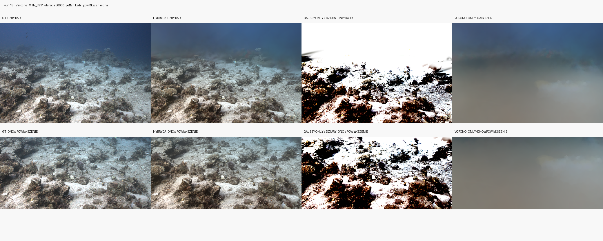

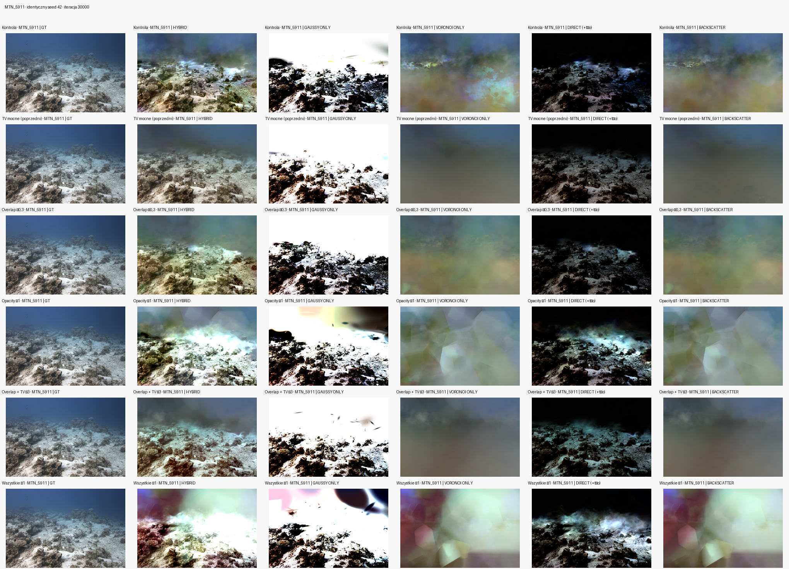

Ten sam układ dla pozostałych kamer: [MTN_5894](figures/07_examples_MTN_5894.png) · [MTN_5903](figures/07_examples_MTN_5903.png) · [MTN_5928](figures/07_examples_MTN_5928.png). **Trzecia kolumna to izolowany render Gaussian-only.** Wiersz „TV mocne” należy najpierw obejrzeć właśnie tam: dno nie jest kompletnie pokryte.

## Co pomyliłem?

Oryginalny sześciokafelkowy panel ewaluacji ma kolejno: **GT | hybryda | błąd | Gaussian-only | Voronoi-only | transmitancja**. Gaussian-only jest więc rzeczywiście **trzecim kafelkiem od prawej**. W poprzednim raporcie zamiast niego pokazywałem `direct_with_background`.

`direct` w rendererze RGB-medium to **światło Gaussianów *oraz przepuszczone światło tła***, mnożone przez transmitancję medium. `backscatter` to światło dodane przez medium. Schematycznie:
`hybryda = direct(Gaussy + tło, filtrowane przez Voronoi) + backscatter(Voronoi)`.
Nawet jeśli Gaussów brakuje na dnie, przestrzennie zmienna transmitancja Voronoi może narysować jego strukturę w `direct`. **Direct nie jest renderem „tylko Gaussy”.** Wskaźnik `D/(D+B)` z poprzedniej wersji **nie mierzy przejęcia dna** i nie używam go do oceny separacji.

## Dwa różne wyniki: jakość obrazu i przejęcie dna

| Wariant, 30k | Hybryda PSNR | Gaussian-only PSNR | Voronoi-only PSNR | Średnie alpha G | Wniosek |
|---|---:|---:|---:|---:|---|
| Kontrola, poprzedni sweep | 21,07 | 5,52 | 16,56 | 0,42 | Brak przejęcia dna |
| **TV mocne**, poprzedni sweep | **24,45** | **5,61** | 16,34 | 0,48 | Najlepsza rekonstrukcja; nadal dziury G |
| Kontrola, nowy sweep | 21,05 | 5,53 | 17,23 | 0,42 | Brak przejęcia dna |
| **O+S ×3**, nowy sweep | **22,36** | **5,51** | 16,08 | 0,49 | Lepsza hybryda, bez poprawy G-only |
| G ×1, nowy sweep | 17,07 | 6,46 | 15,44 | 0,94 | Wyższe alpha, ale zepsuta hybryda |
| G ×3, nowy sweep | 16,13 | 7,59 | 14,89 | 0,99 | Nadal zły G-only i artefakty |

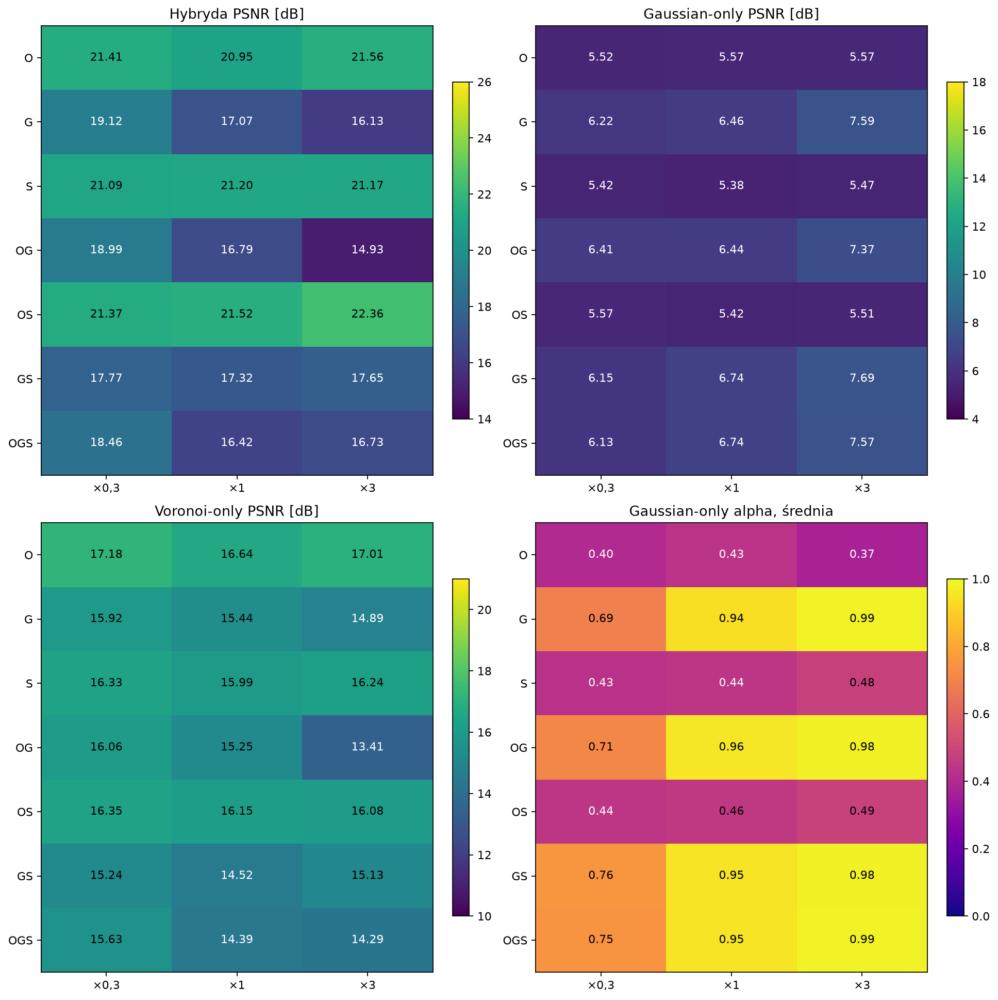

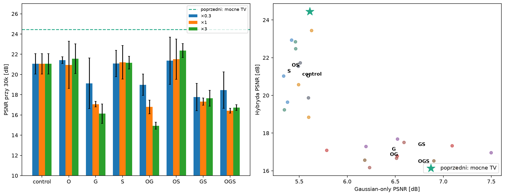

**Ważna granica metryki:** Gaussian-only renderuje scenę *bez wody*, więc jego pełnokadrowy PSNR nie jest samodzielnym testem poprawnego wyglądu podwodnego. Natomiast **widoczne duże dziury na dnie** są bezpośrednim kontrprzykładem dla celu „Gaussy modelują całe dno”. Voronoi-only także nie jest dokładnym udziałem Voronoi w hybrydzie: usuwa okluzję przez Gaussy. Oba rendery są jednak niezbędnymi testami kontrfaktycznymi, których brakowało w raporcie.

### Run 13 „TV mocne”: cztery kamery, nie tylko najlepszy kadr

| Kamera | Hybryda | Gaussian-only | Voronoi-only | Alpha G |
|---|---:|---:|---:|---:|
| MTN_5894 | 23,89 | 6,84 | 15,71 | 0,61 |
| MTN_5903 | 27,76 | 4,66 | 20,54 | 0,27 |
| MTN_5911 | 25,14 | 6,42 | 15,84 | 0,57 |
| MTN_5928 | 26,22 | 5,09 | 17,67 | 0,42 |

[Run 13 w W&B](https://wandb.ai/mlpolska/foamsurf_iui3_rgb_smooth/runs/smooth-513211-13-joint) · [oryginalne PNG Gaussian-only dla MTN_5911](../../../outputs/rgb_smooth/513211/run_13/joint/evaluation/iteration_030000/0002_MTN_5911_gaussian_only.png).

## Poprzedni sweep: TV pomaga hybrydzie, nie pokryciu dna

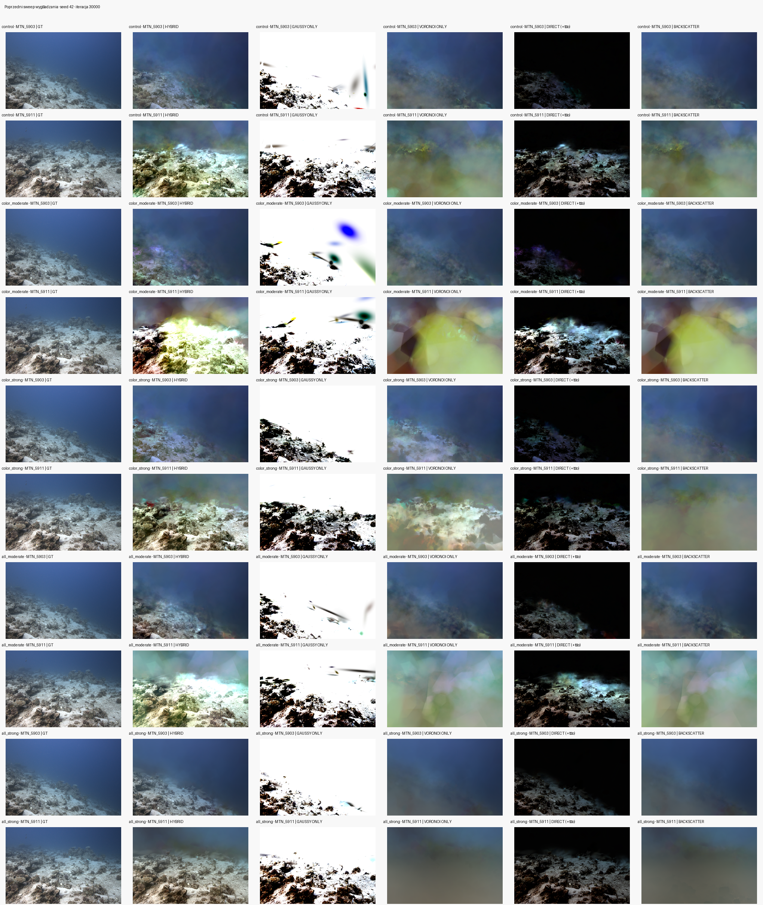

„TV mocne” to regularyzacja absorpcji, backscatter i koloru Voronoi z wagami `(0,1; 0,1; 1)`. Podnosi średni hybrydowy PSNR z **21,07 do 24,45 dB**. Tymczasem Gaussian-only zmienia się z **5,52 do 5,61 dB**; na renderach nie znika problem dziur. Poprawny wniosek: **TV jest korzystne dla rekonstrukcji hybrydowej, ale samo nie rozdziela geometrii dna od medium.** Poprzednia ocena tego wariantu jako najlepszego kompromisu rekonstrukcja–disentanglement była nieuzasadniona.

## Nowy sweep: wpływ każdej funkcjonalności

`O` = kara overlap w podejrzanych miejscach; `G` = `1 − avg(A_G | A_G>0,1)`; `S` = graph TV/Huber na trzech polach medium. Każdy obraz w poniższych galeriach ma kolumny **GT | HYBRID | GAUSSY ONLY | VORONOI ONLY | DIRECT (+tło) | BACKSCATTER**. Siły `×0,3/×1/×3` dotyczą aktywnych lossów.

| Lossy | Hybryda PSNR: ×0,3 / ×1 / ×3 | Gaussian-only PSNR: ×0,3 / ×1 / ×3 | Co się dzieje |
|---|---|---|---|
| O | 21,41 / 20,95 / 21,56 | 5,52 / 5,57 / 5,57 | Nie zapełnia dziur |
| G | 19,12 / 17,07 / 16,13 | 6,22 / 6,46 / 7,59 | Podnosi opacity; niszczy obraz |
| S | 21,09 / 21,20 / 21,17 | 5,42 / 5,38 / 5,47 | Bez przejęcia dna |
| O+G | 18,99 / 16,79 / 14,93 | 6,41 / 6,44 / 7,37 | Oba cele rozjeżdżają się |
| O+S | 21,37 / 21,52 / **22,36** | 5,57 / 5,42 / **5,51** | Poprawa hybrydy, nie G-only |
| G+S | 17,77 / 17,32 / 17,65 | 6,15 / 6,74 / 7,69 | TV nie ratuje G |
| O+G+S | 18,46 / 16,42 / 16,73 | 6,13 / 6,74 / 7,57 | Nadal zły podział |

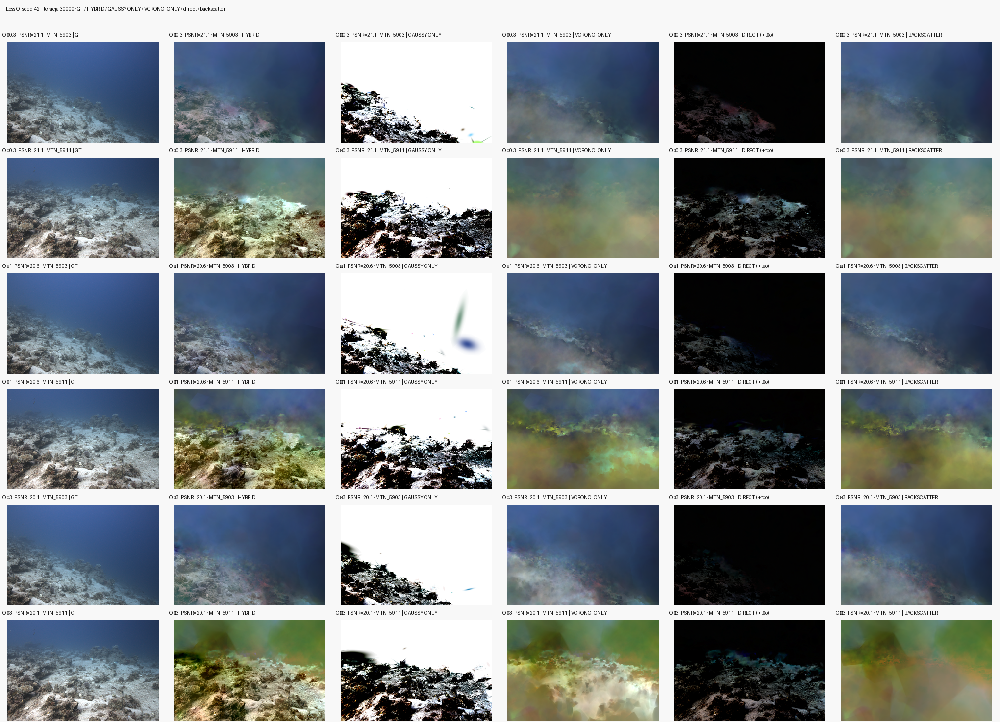
**O osobno:** niewielkie wahania PSNR; Gaussian-only praktycznie niezmieniony. Wyzerowanie mapy podejrzanego overlap nie oznacza przejęcia dna.

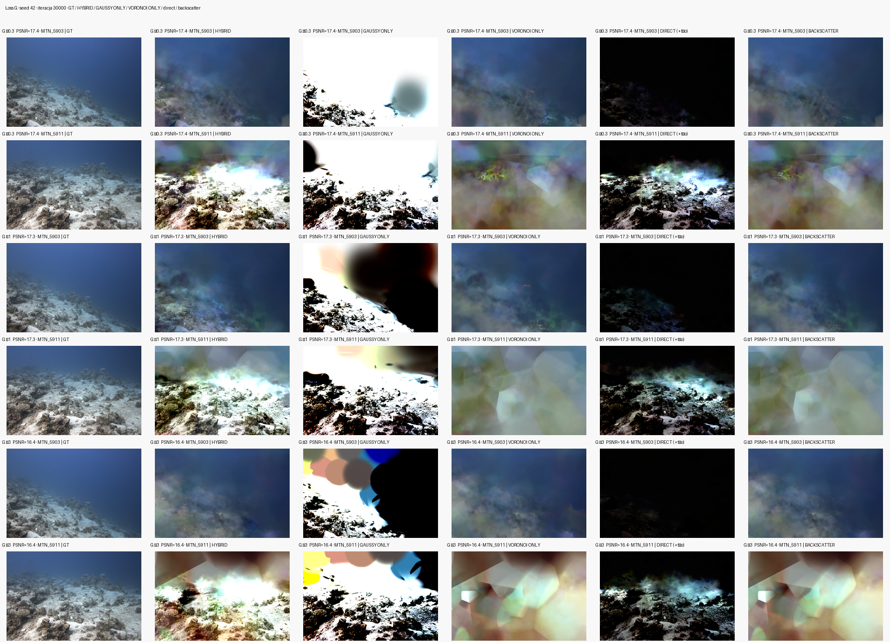
**G osobno:** średnie alpha Gaussian-only rośnie z 0,42 w kontroli do **0,69 / 0,94 / 0,99**, ale obrazy pozostają dziurawe lub nabierają artefaktów, a hybrydowy PSNR spada. Samo „opaque” nie tworzy poprawnej geometrii.

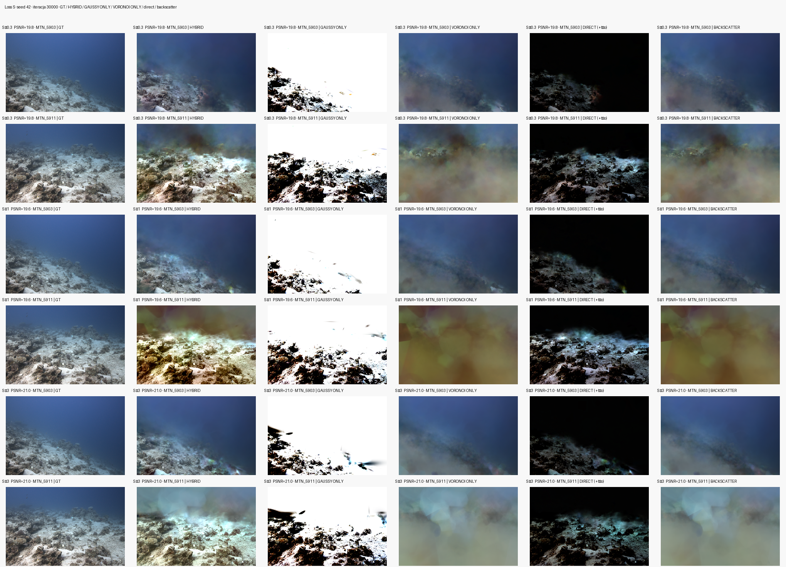
**S osobno:** brak zysku G-only. Nowe `S×3` ma wagi `(0,03; 0,03; 0,3)`, więc jest **słabsze** od starego „TV mocne”; nie należy ich porównywać jako identycznych wag.

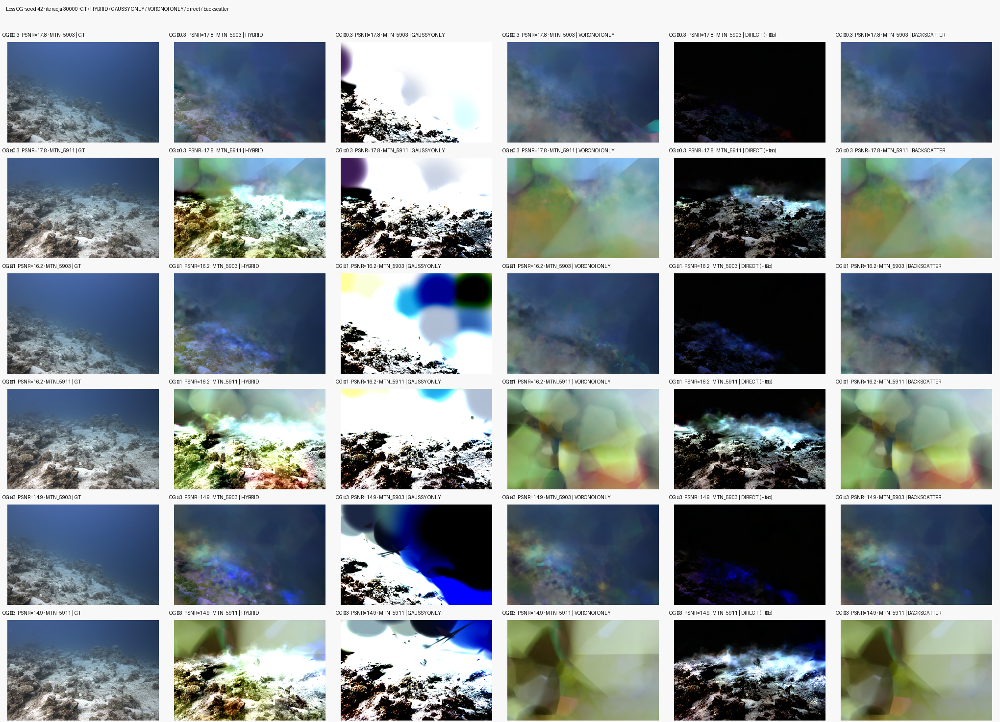
**O+G:** kolejny spadek jakości; overlap nie chroni przed błędnym domknięciem Gaussianów.

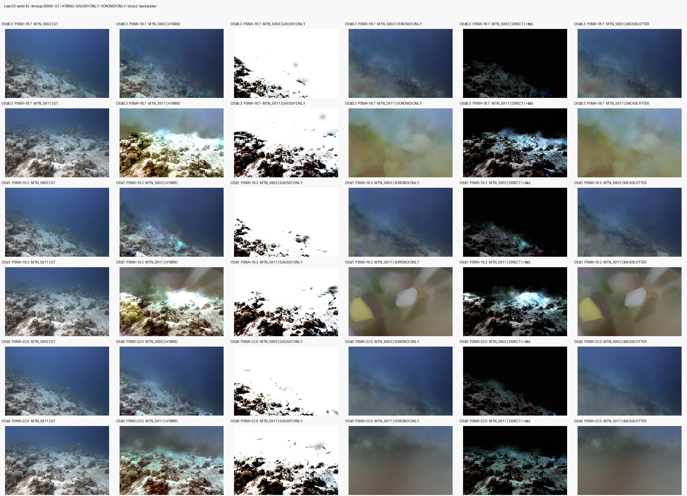
**O+S:** najlepsza hybryda nowego sweepu przy ×3, ale Gaussian-only **5,51 dB** — praktycznie kontrola. To nie jest udany disentanglement.

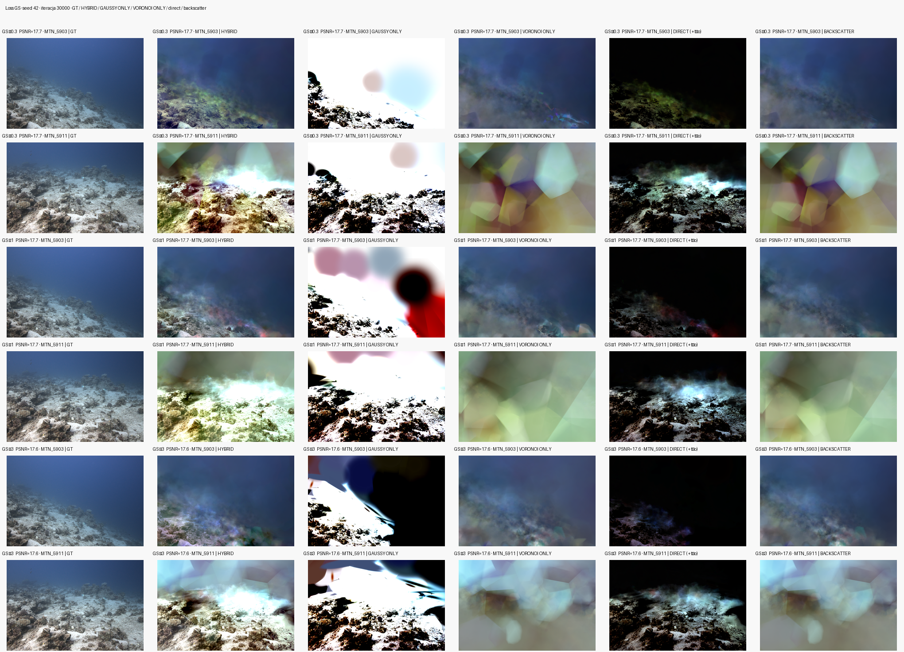
**G+S:** wygładzanie medium nie naprawia błędów wywołanych przez G.

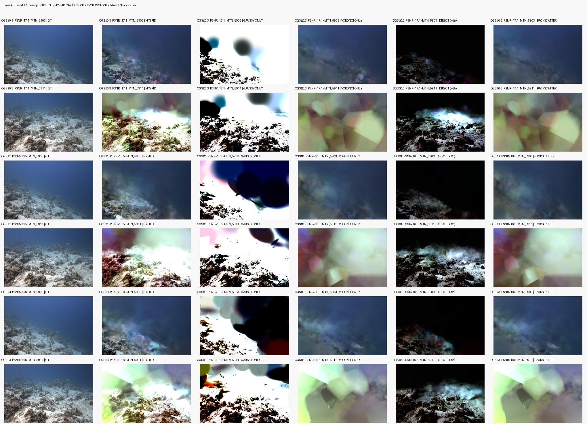
**O+G+S:** wysoka opacity i gorsza hybryda; Gaussian-only nadal daleki od pełnego dna.

## Dynamika i „udział” reprezentacji

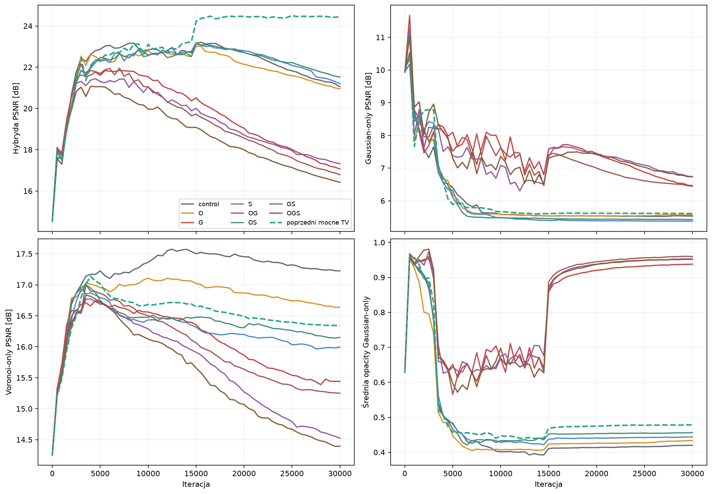

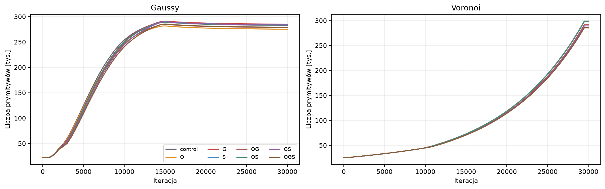

Liczby prymitywów obu gałęzi rosną; **sama populacja nie świadczy o pokryciu dna**. W diagnostyce RGB zapisano też `proxy_responsibility/gaussian_weight_mean` i `.../medium_weight_mean`. Dla „TV mocne” średnie to około **0,02 i 0,97**. To *proxy* z diagnostyki, nie fizycznie konserwatywny udział energii RGB, więc nie należy traktować 2% jako precyzyjnego procentu sceny. Kierunek jest jednak zgodny z renderami: model nie przeniósł dna na Gaussy.

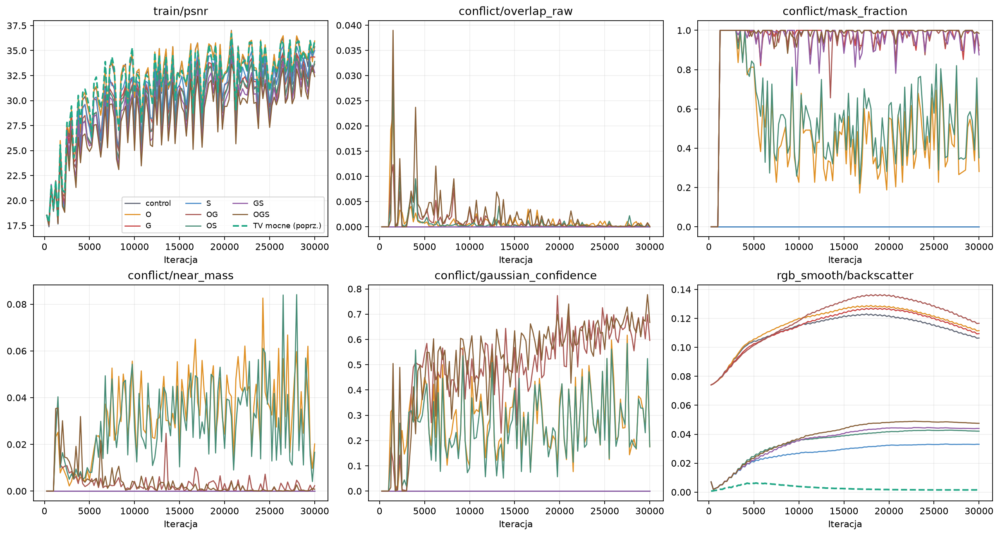

## Podsumowanie

1. **Rekonstrukcja:** „TV mocne” jest najlepszym wariantem *obrazu hybrydowego* — **24,45 ± 1,14 dB**; run 13 osiąga **25,75 dB**.
2. **Disentanglement:** **nieosiągnięty** w obu sweepach. Gaussian-only ma duże luki na dnie i około **5–6 dB** w najlepszych jakościowo wariantach. Nie należy nazywać „TV mocne” baseline'em poprawnej separacji.
3. **Mechanizmy:** O i S mogą poprawiać hybrydę, ale nie rozwiązują pokrycia dna. Obecny G podnosi alpha bez poprawnej geometrii i psuje rekonstrukcję; kombinacje z G także zawodzą.
4. **Następny test:** mierzyć własność **na obszarze dna** — maska dna/solid, mapa pokrycia i błędów Gaussian-only w tej masce oraz udział medium na tych samych promieniach. Pełnokadrowy PSNR i rozkład `direct/backscatter` nie wystarczą.

[Pełna tabela 81 runów](run_summary.csv) · [zestawienie 27 konfiguracji](variant_summary.csv) · [generator obrazów i wykresów](build_report.py). Raport jest przeliczeniem zapisanych wyników, bez ponownego treningu.
